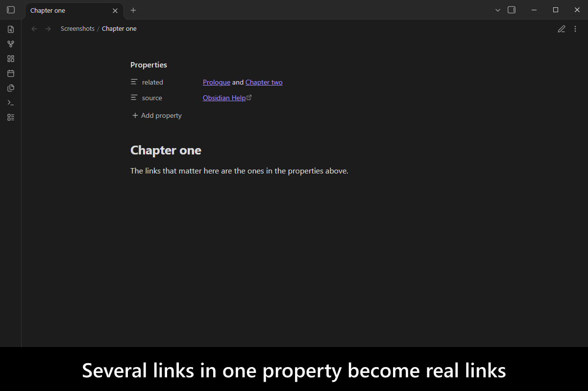
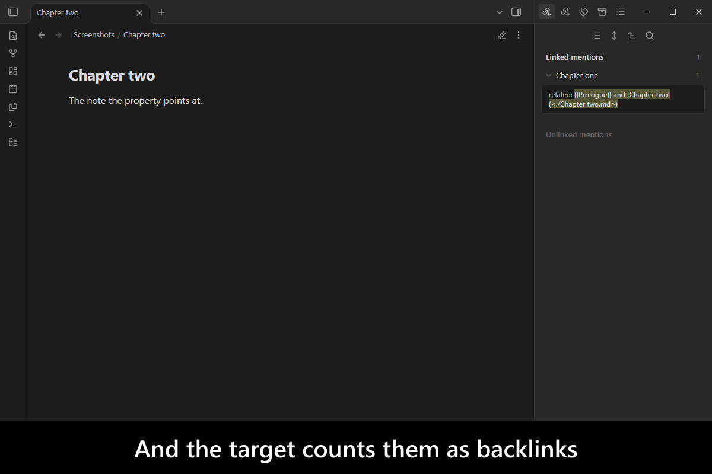
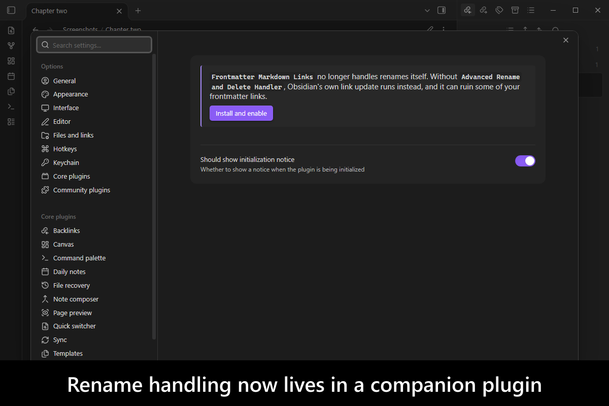
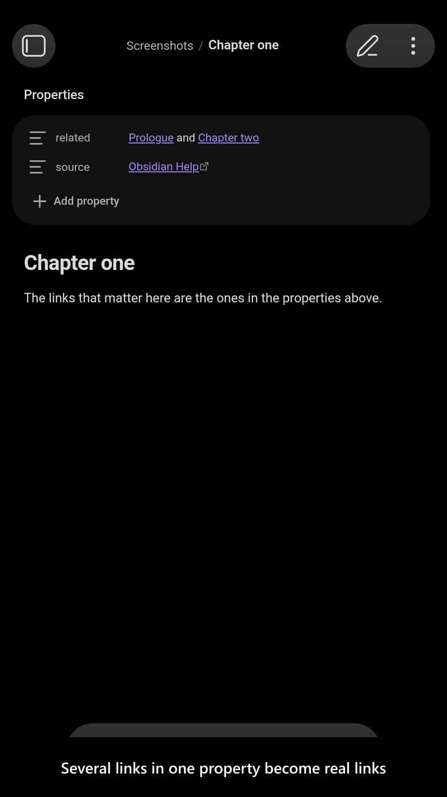
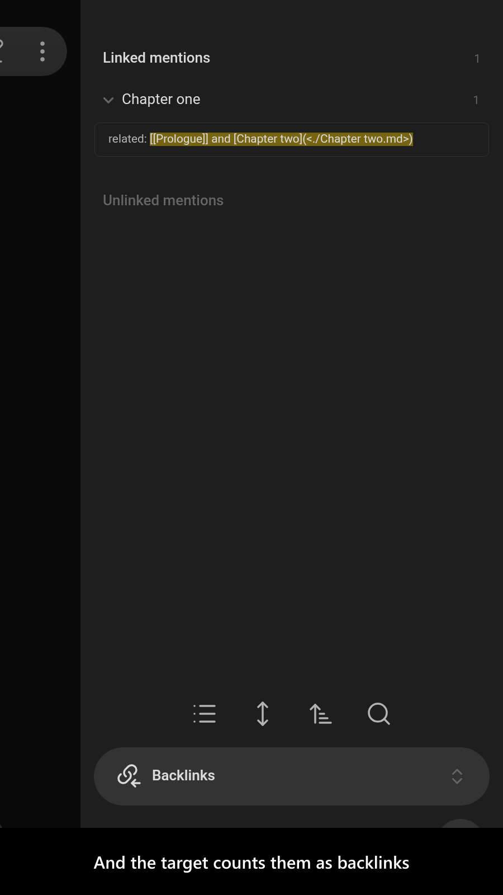
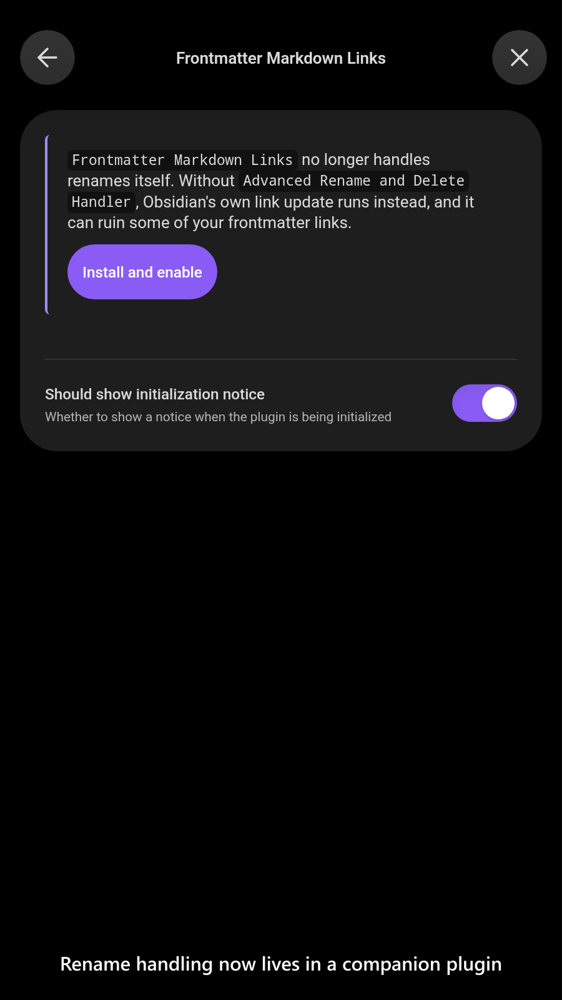

# Frontmatter Markdown Links

[](https://www.buymeacoffee.com/mnaoumov) [](https://github.com/mnaoumov/obsidian-frontmatter-markdown-links/releases) [](https://github.com/mnaoumov/obsidian-frontmatter-markdown-links/releases) [](https://github.com/mnaoumov/obsidian-frontmatter-markdown-links)

[Obsidian](https://obsidian.md/) treats a property whose whole value is one link, `[[wikilink]]` or `[text](note.md)`, as a real link. But put several links in one value, such as `"[[Chapter one]] and [Chapter two](<Chapter two.md>)"`, and Obsidian draws the whole value as one broken link: none of the links in it resolves, opens or counts as a backlink. And while you edit in Source mode, no link in the frontmatter is clickable at all.

This plugin makes every link in frontmatter a real link — each link in a multi-link value on its own, wikilinks and markdown links alike, clickable in Source mode, Live Preview and Reading, resolvable, and counted as a backlink on its target.

Long-requested on the Obsidian forum, for both [internal](https://forum.obsidian.md/t/properties-support-external-markdown-links/76918) and [external](https://forum.obsidian.md/t/properties-support-internal-markdown-links/63825/) links.

<!-- markdownlint-disable MD033 -->

<a href="https://github.com/mnaoumov/obsidian-frontmatter-markdown-links/blob/HEAD/images/screenshots/screenshot-desktop-1.png"></a>

<details>
<summary>More screenshots</summary>

<div>
<a href="https://github.com/mnaoumov/obsidian-frontmatter-markdown-links/blob/HEAD/images/screenshots/screenshot-desktop-2.png"></a>
<a href="https://github.com/mnaoumov/obsidian-frontmatter-markdown-links/blob/HEAD/images/screenshots/screenshot-desktop-3.png"></a>
<a href="https://github.com/mnaoumov/obsidian-frontmatter-markdown-links/blob/HEAD/images/screenshots/screenshot-mobile-1.png"></a>
<a href="https://github.com/mnaoumov/obsidian-frontmatter-markdown-links/blob/HEAD/images/screenshots/screenshot-mobile-2.png"></a>
<a href="https://github.com/mnaoumov/obsidian-frontmatter-markdown-links/blob/HEAD/images/screenshots/screenshot-mobile-3.png"></a>
</div>

</details>

<!-- markdownlint-enable MD033 -->

## Demo vault

**The documentation is a demo vault.** Every feature has a note that explains what it does and why you would want it — and whose own properties are the demonstration.

**[Start reading here](<./demo-vault/00 Start.md>)** — it is plain markdown, so it works on GitHub with nothing installed.

A copy of the vault ships with every release. You can access it via any of the following:

1. Running the **`Frontmatter Markdown Links`: Open demo vault** command.
2. Downloading `frontmatter-markdown-links-demo-vault.zip` from the [Releases](https://github.com/mnaoumov/obsidian-frontmatter-markdown-links/releases). It unzips into a single `frontmatter-markdown-links-demo-vault-<version>` folder.
3. Browsing its source in [`demo-vault/`](./demo-vault/README.md) in this repository.

## What it does

- **Several links in one property become separate real links**, and every frontmatter link is clickable in Source mode too — with paths that contain spaces working either percent-encoded or in angle brackets, and embeds supported too. [01 Frontmatter markdown links](<./demo-vault/01 Frontmatter markdown links.md>)
- **They count as backlinks**, so a note linked only from inside a multi-link property still shows up on its target. [02 Backlinks](<./demo-vault/02 Backlinks.md>)
- **Settings**, including how much of this you want. [03 Settings](<./demo-vault/03 Settings.md>)

## Renames

On a rename, Obsidian itself updates a property whose whole value is one link, markdown or wiki, and each link of a list property. Inside a value holding several links, Obsidian's own update would leave a wikilink pointing at the old name and could write the new name into a different markdown link, so this plugin steers that update to the renamed link alone and leaves the rest of the value as you wrote it. Up to version 2 this plugin handled renames itself. Since **3.0.0** it does not, and rename and delete handling belongs to [Advanced Rename and Delete Handler](https://github.com/mnaoumov/obsidian-advanced-rename-and-delete-handler) instead — one plugin owning it for the whole vault, rather than a copy inside each plugin that happened to need it.

This plugin offers to install it, once, and carries your old `Should handle renames` value over for you to approve. Declining costs you nothing else: every feature above keeps working.

## Installation

The plugin is available in [the official Community Plugins repository](https://community.obsidian.md/plugins/frontmatter-markdown-links).

### Beta versions

To install the latest beta release of this plugin (regardless if it is available in [the official Community Plugins repository](https://community.obsidian.md) or not), follow these steps:

1. Ensure you have the [BRAT plugin](https://community.obsidian.md/plugins/obsidian42-brat) installed and enabled.
2. Click [Install via BRAT](https://intradeus.github.io/http-protocol-redirector?r=obsidian://brat?plugin=https://github.com/mnaoumov/obsidian-frontmatter-markdown-links).
3. An Obsidian pop-up window should appear. In the window, click the `Add plugin` button once and wait a few seconds for the plugin to install.

## Debugging

By default, debug messages for this plugin are hidden.

To show them, run the following command in the `DevTools Console`:

```js
window.DEBUG.enable('frontmatter-markdown-links');
```

For more details, refer to the [documentation](https://mnaoumov.dev/obsidian-dev-utils/guides/debugging/).

## Changelog

All notable changes to this project will be documented in the [CHANGELOG](./CHANGELOG.md).

## Contributing

Contributions are welcome — see [CONTRIBUTING](./CONTRIBUTING.md) to get set up.

## Support

<!-- markdownlint-disable MD033 -->

<a href="https://www.buymeacoffee.com/mnaoumov" target="_blank"></a>

<!-- markdownlint-enable MD033 -->

## My other Obsidian resources

[See my other Obsidian resources](https://github.com/mnaoumov/obsidian-resources).

## License

© [Michael Naumov](https://github.com/mnaoumov/)
